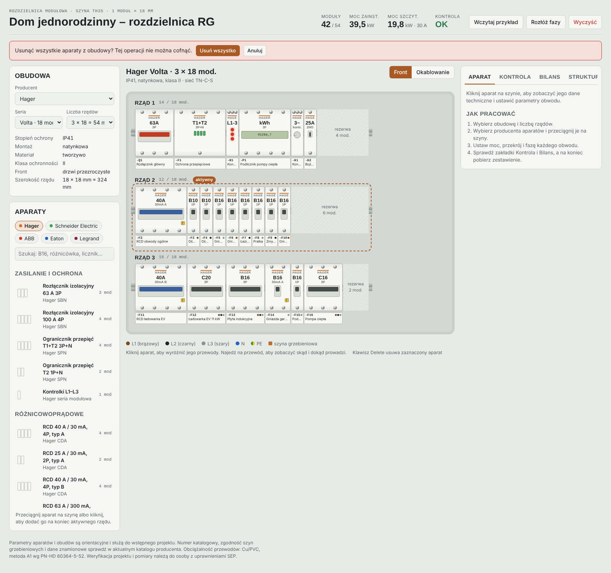
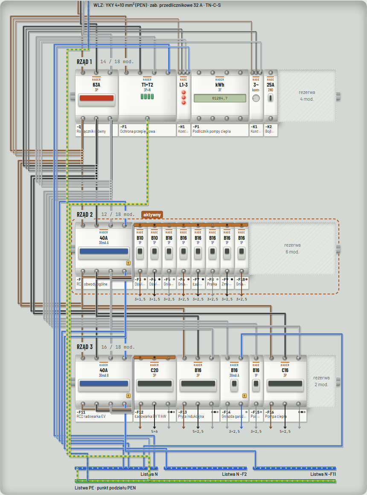

# Przekazanie projektu: Projektant Rozdzielnic

Stan na 14.10.2026, wersja 0.18.0. Projekt powstał w czacie z Claude jako pojedyncza strona (artefakt claude.ai), został podzielony na pliki i jest rozwijany w Claude Code jako zwykła strona w przeglądarce. Wersja 0.5.0 zamyka zadania P0 (1–5 w całości, 6 przygotowane, czeka na decyzję o hostingu). Szczegóły każdej zmiany: `CHANGELOG.md`.



## Cel

Narzędzie dla elektryka lub projektanta do wstępnego zaprojektowania rozdzielnicy mieszkaniowej / małej komercyjnej: dobór obudowy, rozmieszczenie aparatów różnych producentów, kontrola zgodności z podstawowymi wymaganiami PN-HD 60364, okablowanie wnętrza i zestawienie materiałów do zamówienia.

## Co działa (zweryfikowane testami, `npm test`: 269 przechodzi i 4 pominięte, czyli 91 testów × desktop, telefon, safari)

**Obudowa i aparaty**
- 5 producentów: Hager, Schneider Electric, ABB, Eaton, Legrand; 9 serii obudów (12–24 mod./rząd, 1–6 rzędów, IP40–IP65).
- 26 presetów aparatów: rozłączniki, SPD, kontrolki, RCD (A/B, 30/300 mA, S), RCBO, MCB B/C, liczniki MID, styczniki, przekaźniki, zasilacz, gniazdo.
- Przeciąganie z biblioteki i między rzędami (mysz), kliknięcie dodaje do aktywnego rzędu, Delete usuwa, przyciski ← → duplikuj.
- Front aparatów w skali (1 moduł = 34 px), opisówka z oznaczeniem i kropkami faz, rezerwa i przekroczenie szyny.

**Projekty** (nowe w 0.5.0)
- Lista projektów w przeglądarce: wybór, „Nowy”, „Duplikuj”, „Usuń” z potwierdzeniem na stronie; nazwa to tytuł w nagłówku.
- Plik projektu `.rozdz.json`: „Zapisz projekt” (pobranie), „Otwórz projekt” (wybór pliku albo przeciągnięcie na stronę), walidacja, komunikaty błędów, sprowadzanie wartości do dozwolonych. Wczytany plik jest nowym projektem.
- Cofnij / Ponów: przyciski i Ctrl+Z, Ctrl+Shift+Z, Ctrl+Y; 50 kroków; tylko zmiany danych projektu.
- Druk / PDF: A4 poziomo; front, okablowanie, struktura z kontrolą, zestawienie z listami kabli i połączeń.
- Zapis automatyczny w `localStorage` (`rozdz-v2`), migracja z `rozdz-v1`, awaryjny start z przykładem przy uszkodzonym zapisie.

**Panel boczny (6 zakładek)**
- Aparat: parametry aparatu, obwód (rodzaj, moc, przekrój, faza, długość kabla, przypisanie RCD), Ib/In/Iz, dane techniczne.
- Kontrola: 19 reguł (lista w `docs/DOMAIN.md`), klik przenosi do aparatu.
- Bilans: obciążenie faz (wykres SVG) względem zabezpieczenia przedlicznikowego, ustawienia zasilania (moc, przedlicznikowe, ks, cos φ, układ sieci).
- Struktura: drzewo zasilania WLZ → rozłącznik → RCD → obwody.
- Kable: WLZ, kable obwodowe, przewody w rozdzielnicy według przekroju i koloru, lista połączeń, kopiowanie CSV.
- Zestawienie: aparaty + akcesoria + przewody, kopiowanie CSV i opisówki.

**Przewody sterownicze** (0.18.0): cewki styczników (A1/A2), styk przekaźnika kontroli faz (11–14), sygnał G12; rysowane na czerwono, w zestawieniu, w kontroli i w symulacji. Opis: `docs/DOMAIN.md` → „Obwody sterowania”. Zasilacz 24 V nie ma jeszcze zacisków, funkcja przekaźnika czasowego nie jest symulowana.

**Praca offline i instalacja** (0.17.0): `manifest.webmanifest`, `sw.js` („najpierw sieć”), przycisk „Zainstaluj”. Do sprawdzenia na prawdziwym telefonie.

**Schemat jednokreskowy** (0.16.0, `js/schemat.js`): widok „Schemat” i strona wydruku, rysowany z modelu; kliknięcie zaznacza aparat.

**Symulacja** (0.10.0, `js/sim.js`): klikane dźwignie i przycisk T, napięcie na aparatach i przewodach, animacja prądu, awarie (zwarcie, przeciążenie, upływ do PE, zanik fazy) z dziennikiem zdarzeń. Uproszczona: liczy tylko ciągłość torów.

**Okablowanie** (przełącznik Front / Okablowanie)



- Każdy przewód we własnym torze, korytka po obu stronach, osobne zaciski na listwach, kropki rozgałęzień.
- Szyny grzebieniowe automatycznie dla obwodów stojących za swoją różnicówką.
- Listwa PE (podział PEN dla TN-C-S), główna N, osobna N za każdą różnicówką.
- Tryb **Automatyczne / Ręczne** (0.6.0): w ręcznym kliknięcie dwóch zacisków dodaje przewód, a `wireCheck()` zgłasza złe podłączenia (lista reguł w `docs/DOMAIN.md`). Opis w `CHANGELOG.md`.
- Filtr żył L1/L2/L3/N/PE, wyróżnianie przewodów zaznaczonego aparatu, opis przewodu po najechaniu.

**Inne**
- Jasny i ciemny motyw (systemowy), układ od 390 px szerokości.
- CI: `.github/workflows/pages.yml` (testy w Chromium, WebKit i Firefox, potem publikacja na GitHub Pages). Plik jest gotowy, ale **nie był jeszcze uruchomiony**: projekt nie ma zdalnego repozytorium.

## Historia decyzji

| Decyzja | Powód |
|---|---|
| Czysty HTML/CSS/JS bez frameworka i budowania | Artefakt claude.ai musiał być jednym plikiem; teraz pozwala otworzyć `index.html` z dysku. Migracja do Vite + TS jest w planie (P2), po rozbudowie testów. |
| Pełne przerysowanie `innerHTML` przy każdej zmianie | Prosty model, mało stanu w DOM; przy ~50 aparatach wydajność jest wystarczająca. |
| Wartości pochodne liczone zawsze od nowa | Brak rozjazdów między modelem a widokiem. |
| Okablowanie jako nakładka SVG mierzona z DOM | Front aparatów to HTML/CSS; przewody muszą trafiać w rzeczywiste położenie zacisków. |
| Każdy przewód we własnym torze, piony po obu stronach | Pierwsza wersja (wspólne tory) była nieczytelna. Użytkownik poprosił, żeby wszystkie kable były widoczne. |
| Usunięcie `?.` i `??` | Po wersji 3 użytkownik zgłosił „nie ładuje się”. Nie udało się odtworzyć w Chromium; podejrzenie: stary Safari/WebKit. |
| Potwierdzenia na stronie zamiast `confirm()` | Ograniczenie artefaktu; zostaje jako lepszy UX. |
| Brak numerów katalogowych i cen | Nie podajemy danych katalogowych z pamięci; czekamy na cenniki od użytkownika. |
| Wszystkie projekty w jednym kluczu `rozdz-v2` | Jedna operacja zapisu, prosta migracja z `rozdz-v1`. Ograniczenie: limit `localStorage` (ok. 5 MB) na wszystkie projekty razem; jeden projekt to kilka kB. |
| Wczytany plik to nowy projekt, a nie podmiana bieżącego | Otwarcie pliku nigdy nie niszczy pracy. |
| Historia cofania jako migawki JSON tworzone w `save()` | Każda akcja jest cofalna bez zmian w jej kodzie. Koszt: do 50 kopii danych projektu w pamięci (pomijalny). |
| Druk przez kopię HTML obudowy w `#print` | Rysunek przewodów zależy od pomiaru DOM na ekranie; kopia z zachowanymi wymiarami i skalą daje identyczny rysunek (sprawdza to test). |
| Firefox tylko w CI | Firefox z Playwright nie startuje na komputerze użytkownika (Windows Insider, błąd SideBySide). Użytkownik pracuje w Operze (Chromium). |

## Znane problemy i ograniczenia

1. **Niepotwierdzona przyczyna „nie ładuje się”** (zgłoszenie z wersji w claude.ai). Testy przechodzą w Chromium i WebKit bez zmian w kodzie aplikacji, więc błędu nie udało się odtworzyć. W Firefoksie aplikacja **nie była testowana** (patrz tabela decyzji); sprawdzi to pierwsze uruchomienie CI.
2. **Dotyk sprawdzono tylko w testach z symulowanymi zdarzeniami**, nie na fizycznym telefonie. Przeciąganie z biblioteki palcem nie działa; stuknięcie pozycji dodaje aparat do aktywnego rzędu.
3. **Okablowanie na wydruku jest małe** (skala ok. 0,5 przy 3 rzędach), bo wysoka obudowa musi się zmieścić na A4 poziomo. Do rozważenia: strona pionowa dla okablowania albo podział na rzędy.
4. **Historia cofania znika po przeładowaniu strony** i przy zmianie projektu.
5. **Usunięcia projektu nie da się cofnąć** (jest potwierdzenie i podpowiedź, żeby wcześniej zapisać plik).
6. **Przekaźnik czasowy, zasilacz i gniazdo nie są okablowane.** Licznik i stycznik są (od 0.14.0), ale tylko w torze mocy: przewodów sterowniczych (cewka, styk przekaźnika kontroli faz, sygnał taryfy) aplikacja nie rysuje ani nie liczy w zestawieniu.
7. **Szyna grzebieniowa tylko dla ciągłego bloku MCB bezpośrednio za RCD.** Nie sprawdzamy zgodności szyn między producentami ani rozstawu biegunów.
8. **Obliczenia są uproszczone** (od 0.12.0 liczone są spadek napięcia, pętla zwarcia i Ik względem Icn): sama rezystancja przewodów Cu, bez reaktancji, PE o przekroju fazowego, bez współczynników poprawkowych Iz i bez selektywności wg charakterystyk. Dane sieci mają wartości domyślne przykładowe.
9. **Szerokości aparatów uproszczone** (np. RCBO 1P+N zawsze 2 mod., choć są wersje 1-modułowe).
10. **Przy wielu obwodach obudowa w widoku okablowania robi się wysoka**; brak powiększania i przesuwania.
11. W `css/styles.css` reguły `.cabinet.wiring { padding … }` i `.cabinet.wiring .rowwrap { margin-top … }` są nadpisywane przez style inline z `drawWires()`; do uporządkowania.
12. Faza RCD 2P jest wyznaczana z pierwszego przypisanego obwodu 1F (`rcdPh`), a nie ustawiana jawnie.
13. Zakresy przekrojów zacisków aparatów (`termRange()`) są orientacyjne, wpisane bez kart katalogowych producentów.

**CI, WebKit na Linuksie:** pojedyncze testy czasem zawieszają się na akcji Playwright (rzadko, losowo, niezależnie od zmian w aplikacji; sprawdzone eksperymentami, opis w `CHANGELOG.md`). CI ma jedną ponowną próbę; jeśli test zacznie zawodzić stale, to już nie ten problem.

Z przeglądu kodu 0.14.1 — **wszystkie naprawione w 0.15.0** (szczegóły w `CHANGELOG.md`). Zostaje tylko część punktu o stylu kodu: wspólna przestrzeń globalna (plan P2). Lista dla porządku:

- **„Rozłóż fazy” w okablowaniu ręcznym** zmienia fazy obwodów, ale nie przepina przewodów, więc tworzy błędy „dwie różne fazy”. Przycisk naprawy przy asymetrii nie powinien być wtedy oferowany albo powinien przepinać przewody.
- **Zaciski listew:** gdy przewodów jest więcej niż miejsc na listwie (`barX()` w `drawWires()`), kolejne trafiają w ten sam punkt bez ostrzeżenia.
- **Dostępność:** przewody można dodawać tylko myszą lub dotykiem; zakładki nie mają `aria-controls` ani obsługi strzałek.
- **Prywatność i praca offline:** czcionki są ładowane z Google Fonts.
- **Backspace** usuwa zaznaczony aparat (cofalne, ale łatwo o pomyłkę).
- **Wpisy w `PR.bad`** nie mają interfejsu: nie da się ich pobrać ani usunąć z poziomu aplikacji.
- **Styl kodu:** linie po 300–400 znaków i wspólna przestrzeń globalna utrudniają przegląd (plan P2: Vite + TypeScript).

Naprawione w 0.5.0: pasek potwierdzenia „Wyczyść” widoczny od startu i podpowiedź o przewodach widoczna w widoku frontu (atrybut `hidden` nadpisywany przez `display`).

## Plan prac

Kolejność według wartości dla użytkownika. Każde zadanie kończy się zielonym `npm test`, nowymi testami dla nowej funkcji i wpisem w `CHANGELOG.md`.

### P0 — stabilnie w przeglądarce

1. ✅ **Testy w kolejnych silnikach.** WebKit lokalnie, Firefox w CI.
2. ✅ **Zapis i odczyt pliku projektu** (`.rozdz.json`).
3. ✅ **Lista projektów** w `localStorage`, migracja z `rozdz-v1`.
4. ✅ **Cofnij / Ponów.**
5. ✅ **Widok do druku / PDF.**
6. ✅ **Hosting.** GitHub Pages: https://kacprolog.github.io/rojektant-rozdzielnic/ (repozytorium `Kacprolog/rojektant-rozdzielnic`). Każdy push na `main` uruchamia testy w Chromium, WebKit i Firefoksie, a po sukcesie publikuje `index.html`, `css/`, `js/`.

### Interaktywność — kolejne kroki (z burzy mózgów 11.10.2026)

- ✅ Pasek szybkiej edycji pod zaznaczonym aparatem (0.11.0). Do zrobienia: edycja mocy i nazwy w miejscu.
- ✅ Kontrola z przyciskami napraw (0.11.0). Do zrobienia: naprawy dla braku zasilania zacisku i przeciążonej różnicówki.
- ✅ Powiększanie obudowy i przenoszenie aparatów palcem (0.13.0). Do zrobienia: powiększanie gestem dwóch palców, sprawdzenie na fizycznym telefonie.
- ✅ Symulacja zwarcia korzysta z obliczonego prądu (0.12.0). Do zrobienia: czasy zadziałania z charakterystyk.
- Odłożone: budowanie rozdzielnicy z listy pomieszczeń i odbiorników.

### P1 — merytoryka

7. **Schemat jednokreskowy** generowany z modelu (SVG): WLZ, rozłącznik, SPD, RCD, obwody z oznaczeniami, przekrojami, długościami i mocami. Dodać jako stronę wydruku.
8. **Katalog w JSON** (`data/catalog/*.json`): numery katalogowe, ceny, szerokości i warianty per producent; import cennika CSV od użytkownika; wartość zestawienia.
9. ✅ (0.12.0, w wersji uproszczonej) **Rozszerzone obliczenia**. Zostało: reaktancja i przekrój PE inny niż fazowy, współczynniki poprawkowe Iz (temperatura, grupowanie), selektywność wg charakterystyk, układ TT z rezystancją uziemienia RA. Pierwotny opis: spadek napięcia (ΔU ≤ 3% obwody odbiorcze, ≤ 0,5% WLZ – parametry do ustawienia), impedancja pętli i warunek samoczynnego wyłączenia, Ik w miejscu instalacji vs Icn, współczynniki poprawkowe Iz. Każde jako reguła w `checks()` z odwołaniem do normy.
10. ✅ (0.14.0, tor mocy i sterowanie w symulacji) **Obwody sterowania i pomiaru**. Zostało: przewody sterownicze 1,5 mm² na rysunku i w zestawieniu, przekaźnik czasowy i zasilacz. Pierwotny opis: licznik w torze obwodu (np. pompa ciepła), stycznik dla bojlera z sygnałem taryfy G12, przekaźnik kontroli faz z cewką stycznika. Zaciski sterownicze w `terms()`, przewody 1,5 mm².
11. **Obsługa dotyku**: przeciąganie na Pointer Events, powiększanie i przesuwanie obudowy, większe cele dotyku.

### P2 — technika

12. **Migracja do Vite + TypeScript** (moduły ES, typy `Device`, `Conn`, `Endpoint`), testy jednostkowe modelu w Vitest (`checks`, `buildConns`, `bomRows`, `ib/iz`). Zachować działanie bez serwera przez `vite build` z jednym plikiem wynikowym (np. `vite-plugin-singlefile`), jeśli otwieranie z dysku ma zostać.
13. **PWA** (manifest, service worker), praca offline, instalacja na telefonie.
14. Porządek w CSS (punkt 11 z listy problemów), podział `render.js` na komponenty.

## Jak sprawdzić, że wszystko działa

```bash
npm install && npx playwright install chromium webkit
npm test
npm start   # otwórz http://localhost:4173
```

Ręczny scenariusz podstawowy: wczytaj przykład → kliknij rząd 3, potem w bibliotece „RCD 25 A / 30 mA, 2P” (trafi na koniec rzędu) → w Kontroli pojawi się informacja, że różnicówka nie ma obwodów → zaznacz „Podgrzewacz wody” i w polu „Ochrona RCD” wybierz nową różnicówkę → informacja zniknie, a w Okablowaniu pojawi się osobna listwa N za tą różnicówką i przewód L3 do wyłącznika.

Ręczny scenariusz 0.5.0: „Cofnij” dwa razy (wraca stan sprzed przypisania i sprzed dodania RCD) → „Zapisz projekt” (pobiera plik) → „Nowy” (pusta obudowa, lista ma 2 projekty) → przeciągnij pobrany plik na stronę (trzeci projekt, 21 aparatów) → „Drukuj / PDF” i w oknie druku „Zapisz jako PDF”.
