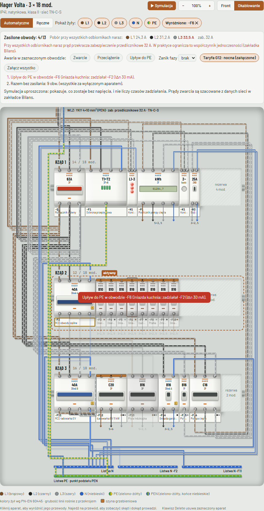
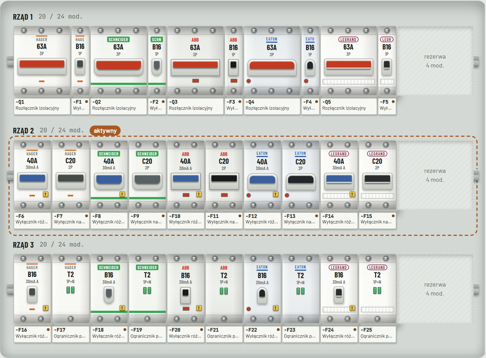

# Projektant Rozdzielnic

Interaktywny konfigurator rozdzielnic modułowych działający w przeglądarce: obudowy i aparaty Hager, Schneider Electric, ABB, Eaton i Legrand, kontrola projektu według PN-HD 60364, bilans faz, widok okablowania z szynami grzebieniowymi i listwami N/PE, lista kabli i zestawienie materiałów.


Symulacja po upływie do PE: różnicówka wybita, obwody za nią bez napięcia.



Fronty aparatów pięciu producentów (rysunki własne, uproszczone):



**Wersja online:** https://kacprolog.github.io/rojektant-rozdzielnic/

## Co potrafi

| Funkcja | Jak użyć |
|---|---|
| Układanie aparatów | Przeciągnij z biblioteki na szynę albo kliknij (trafi do aktywnego rzędu) |
| Kontrola projektu | Zakładka „Kontrola”: klik przenosi do aparatu, a przycisk przy uwadze wykonuje naprawę (np. „Ustaw In 25 A i przewód 4 mm²”, „Dodaj różnicówkę”) |
| Licznik i stycznik | W panelu aparatu wybierz „W torze obwodu”: aparat zostaje wpięty za wyłącznik tego obwodu. Stycznik ma sterowanie cewki (ręczne, taryfa G12, przekaźnik kontroli faz), które działa w symulacji |
| Obliczenia | Panel aparatu pokazuje spadek napięcia, pętlę zwarcia i prąd zwarcia obwodu; dane sieci (Zs i Ik w złączu, długość WLZ) ustawiasz w zakładce „Bilans” |
| Powiększenie | Przyciski − / + nad obudową albo Ctrl + kółko myszy; środkowy przycisk dopasowuje obudowę do szerokości okna |
| Telefon i tablet | Przytrzymaj aparat palcem i przeciągnij go na nowe miejsce; przewody ciągnie się od zacisku do zacisku |
| Szybka edycja | Kliknij aparat w widoku frontu: pod nim pojawia się pasek z fazą, prądem − / +, charakterystyką, przesuwaniem, kopią i usunięciem |
| Okablowanie | Przełącznik „Front / Okablowanie / Schemat” nad obudową; tryb „Automatyczne” rysuje przewody sam |
| Schemat jednokreskowy | Przycisk „Schemat” nad obudową: schemat rysowany z projektu (zasilanie, rozłącznik, różnicówki, obwody z kablami i mocą); kliknij obwód, żeby go edytować. Jest też na wydruku |
| Własne przewody | W okablowaniu wybierz „Ręczne”: przeciągnij przewód od zacisku do zacisku (zielone zaciski są poprawne, czerwone dadzą błąd) albo kliknij zacisk, potem drugi. Kliknij przewód i Delete, żeby usunąć. „Przejmij automatyczne” daje gotowy punkt wyjścia |
| Edycja przewodu | Kliknij przewód w trybie ręcznym: przekrój, kolor izolacji, „Przepnij początek / koniec”, „Usuń przewód” |
| Kolory żył | Wg PN-EN 60445 w jasnym i ciemnym motywie: L1 brązowy, L2 czarny, L3 szary, N niebieski, PE zielono-żółty, PEN zielono-żółty z niebieskimi końcami; kolor niezgodny z normą daje alert |
| Alerty złego podłączenia | W trybie ręcznym: czerwony komunikat od razu, obwódka na przewodzie i wpis w „Kontroli” (zwarcia, ominięta różnicówka, wspólny N, brak zasilania) |
| Symulacja | „▶ Symulacja”: klikaj dźwignie, żeby wyłączać aparaty; widać, co traci napięcie i którędy płynie prąd. Przycisk T testuje różnicówkę |
| Awarie | W symulacji zaznacz obwód i wybierz „Zwarcie”, „Przeciążenie” albo „Upływ do PE”; „Zanik fazy” dotyczy zasilania. Dziennik opisuje, co zadziałało |
| Wiele projektów | Lista „Projekt” oraz „Nowy”, „Duplikuj”, „Usuń”; nazwa to tytuł w nagłówku |
| Plik projektu | „Zapisz projekt” pobiera `.rozdz.json`; „Otwórz projekt” albo przeciągnięcie pliku na stronę |
| Cofanie | „Cofnij” / „Ponów”, Ctrl+Z, Ctrl+Shift+Z, Ctrl+Y (50 kroków) |
| Druk i PDF | „Drukuj / PDF”: front, okablowanie, struktura z kontrolą, zestawienie (A4 poziomo) |

Projekty zapisują się automatycznie w przeglądarce (`localStorage`). Żeby przenieść projekt na inny komputer albo zrobić kopię, użyj „Zapisz projekt”.

## Uruchomienie

**Najprościej:** otwórz `index.html` dwuklikiem w Operze, Chrome, Edge, Firefoksie lub Safari. Nie trzeba niczego instalować.

**Z serwerem lokalnym** (wymaga Node.js 18+):

```bash
npm start
```

i otwórz http://localhost:4173.

## Publikacja w internecie

Aplikacja to statyczne pliki (`index.html`, `css/`, `js/`), więc wystarczy dowolny hosting plików.

- **GitHub Pages (automatycznie, z testami):** wypchnij repozytorium na GitHub, w Settings → Pages ustaw Source: „GitHub Actions”. Plik `.github/workflows/pages.yml` uruchamia testy i po sukcesie publikuje stronę przy każdym pushu na `main`.
- **Netlify (ręcznie):** przeciągnij folder z `index.html`, `css/` i `js/` na https://app.netlify.com/drop.

## Testy

```bash
npm install
npx playwright install chromium webkit
npm test
```

Testy działają w trzech projektach: `desktop` (Chromium 1600 px; ten sam silnik co Opera, Chrome, Edge), `phone` (Chromium 390 px), `safari` (WebKit). Firefox włącza się w CI albo lokalnie przez zmienną `PW_FIREFOX=1`.

Podgląd wydruku bez drukowania: `node scripts/podglad-druku.js` zapisuje PDF i zrzuty stron w `test-results/druk/`.

## Dokumentacja

- `CHANGELOG.md` – dziennik zmian: co, dlaczego i jak sprawdzono, wpis na każdy commit
- `HANDOFF.md` – stan projektu, decyzje, znane problemy, plan prac
- `CLAUDE.md` – kontekst dla Claude Code: architektura i zasady zmian
- `docs/DATA_MODEL.md` – model danych, format pliku, połączenia, algorytm prowadzenia przewodów
- `docs/DOMAIN.md` – reguły elektryczne i tabele

Parametry aparatów są orientacyjne. Projekt wymaga weryfikacji przez osobę z uprawnieniami SEP.
